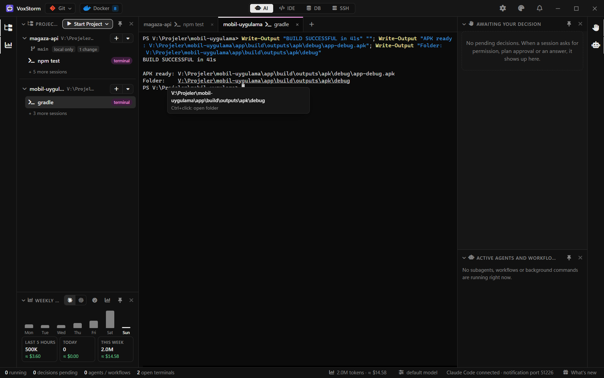
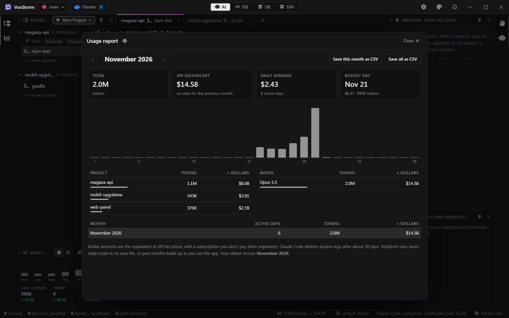
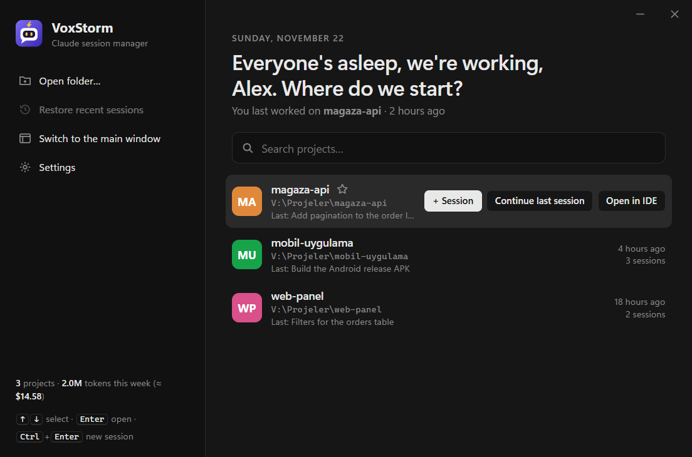
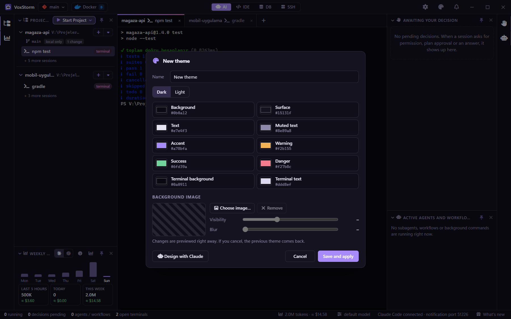
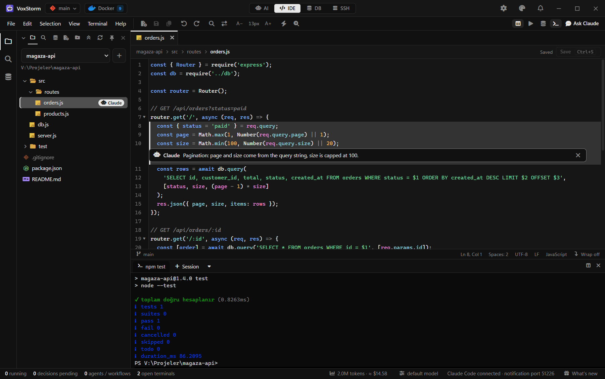
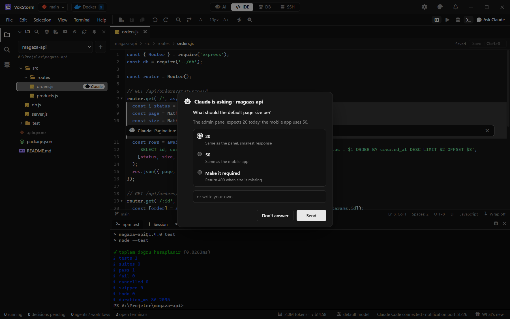
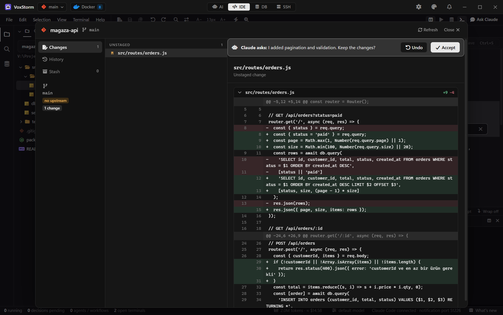

# VoxStorm

A desktop app that runs your Claude Code and Codex sessions in one window. IDE, database, SSH, Docker and git live in the same place, and Claude and Codex can use VoxStorm too: they open a file in front of you, show a change and ask for your approval, ask questions, and tell you when a job is done.

Runs on Windows, macOS and Linux. The interface is available in English, Turkish, German, Spanish and French. · *Türkçe: [README.md](README.md)*

> Not an official Anthropic product. It works with the [Claude Code](https://claude.com/claude-code) (and/or OpenAI Codex) installed on your computer.



## Contents

- [Features](#features)
- [Claude and Codex use VoxStorm](#claude-and-codex-use-voxstorm)
- [Install](#install)
- [Development](#development)
- [How it works](#how-it-works)
- [Project layout](#project-layout)

## Features

### AI mode: sessions

- **Tabbed terminals:** Claude, Codex, PowerShell, Command Prompt and Git Bash side by side (zsh and bash on macOS and Linux). Tab groups, reopen closed tabs, drag files onto a terminal.
- **Projects and history:** Click an old session to continue where you left off; restore what was open at shutdown. Right-click a project: show in the IDE, open in File Explorer, refresh history.
- **Decision panel:** Permission requests, plan approvals and Claude's questions in one place.
- **Agents and workflows:** Subagents, background commands and workflows in a live list; a workflow window with phases, agents, tokens and time.
- **Sessions outside VoxStorm:** Watch Claude sessions open in another terminal, and move them into VoxStorm if you like.
- **Notifications and tray:** Get notified when a job finishes or a decision is waiting. Closing the window keeps VoxStorm running in the tray.
- **Clickable paths:** File and folder paths in terminal output become links. **Ctrl+click** opens a folder in File Explorer and a project file in the IDE (at its line, like `src/app.js:49`). Paths with spaces and long paths that Claude wraps onto the next line are recognised; only paths that really exist on disk become links.

### IDE mode

File tree, syntax-highlighted editor, Markdown view, find and replace (regex), multiple cursors, code folding, git colours. "Ask Claude" sends the file or the selected lines to an open session. Run SQL right from the editor in the **DB** panel.

Files, Search, Database and Plugins are **dock panels** like in AI mode: drag them left or right, stack them, make tabs, hide them with the pin. The IDE layout is saved separately from AI mode.

### DB, SSH, Docker, git

- **DB mode:** MSSQL, PostgreSQL, MySQL and MariaDB. Explorer, query tabs, result grid, history and saved queries, CSV export.
- **SSH mode:** Saved servers, terminal, a two-pane SFTP file manager, port-forwarding tunnels and Remote Desktop (RDP) entries.
- **Docker:** Start / stop containers, live logs, a terminal in a container, compose projects, images. On this computer or on a server you are connected to over SSH.
- **Git:** Changes, history, stash, diff view, sync and GitHub info.

### Usage

Weekly and monthly tokens, the dollar equivalent at API prices, per project and per model, plan limits, CSV export. Claude and Codex separately.



### More

- **Modes in their own window:** Move AI, IDE, DB or SSH to a window of their own (e.g. a second monitor).
- **Plugins:** Add your own panel, button, menu item or command; offer tools to Claude. Guide (Turkish): [`src/plugin-sdk/REHBER.md`](src/plugin-sdk/REHBER.md).
- **Personal touch:** Form of address and tone; side panels you can drag and split; shortcuts (F1).
- **Automatic updates:** A new version is downloaded, verified with SHA-256 and installed on restart.



### Themes

Four built-in themes (Night purple, Sea, Graphite, Paper) plus your own:

- **Theme editor:** Pick ten base colours (background, surface, text, accent, warning, terminal…); VoxStorm works out the shades in between, with a live preview.
- **Background picture:** Choose an image and set its visibility and blur; panels sit semi-transparent on top of it.
- **Design with Claude:** Say "sunset, a dark theme with a warm orange accent"; Claude picks the colours, keeps the contrast readable, then saves and applies the theme.



### Languages

The interface is available in English, Turkish, German, Spanish and French. The first start follows your system language; change it in **Settings → Language**. The language Claude and Codex answer in is chosen separately. Adding a language is a single translation file: [`src/i18n/README.md`](src/i18n/README.md).

## Claude and Codex use VoxStorm

Every Claude Code and Codex session VoxStorm starts connects to VoxStorm's local MCP server. So instead of printing something into the terminal and leaving it there, the agent **shows** you and **asks** you. Everything happens in VoxStorm's own interface; no system message boxes.

Ask "where is the orders endpoint?" and VoxStorm comes to the front, switches to the IDE, the file blinks in the tree with a Claude badge and opens in the editor; Claude can mark the lines it wants you to look at, with notes:



When a decision is needed it asks a question with options; your answer goes straight back to the session:



It can show its change in the git window and ask for approval. Choose **Undo** and it reverts the change itself:



| Tool | What it does |
|---|---|
| `show_file` | Opens a file in the IDE and marks it in the tree; or only shows where it is |
| `highlight_lines` | Marks line ranges and writes a note under each |
| `get_editor_state` | Open file, cursor, selected text, unsaved files |
| `show_diff` | Shows the diff in the git window; optionally asks Accept / Undo |
| `ask_user` | A question with options, multiple choice or a written answer |
| `notify_user` | A desktop notification; clicking it goes to the session's tab |
| `run_in_terminal`, `list_terminals`, `read_terminal` | Starts a command in a visible tab, lists and reads terminals |
| `send_to_session` | Sends a message to another Claude / Codex session (asks the first time) |
| `docker_list`, `docker_logs`, `docker_action` | Containers on this computer; start / stop / restart with approval |
| `list_connections`, `ssh_exec`, `ssh_upload`, `ssh_download` | Commands and SFTP on saved SSH servers; if `sudo` needs a password, VoxStorm asks you |
| `db_query`, `show_query` | Queries on saved databases; show a result as a table in DB mode |
| `list_plugin_tools`, `call_plugin_tool` | Tools offered by plugins |
| `get_theme`, `save_theme` | Reads the interface theme; designs, saves and applies a new one |

**Security:** The address, user name and password of SSH and database connections are never given to the agent; VoxStorm opens the connection and the agent only sees the output. You are asked the first time a connection is used (with an optional "always remember"). For commands that need **sudo**, VoxStorm first tries passwordless sudo; if a password is needed it asks you in its own window, showing the command, and passes it to the command with `sudo -S`; the agent never gets the password. Writes are blocked on read-only connections; DROP, TRUNCATE and UPDATE/DELETE without WHERE are confirmed every time. You can turn the SSH and DB tools off in Settings; the other tools stay on.

## Install

Download from the [Releases](../../releases) page.

### Windows

- `VoxStorm-Setup-x.y.z.exe`: regular installer
- `VoxStorm-Portable-x.y.z.exe`: no install, a single file

Requires Windows 10/11 and the `claude` (Claude Code) and/or `codex` command on PATH. Git Bash is optional.

The files are unsigned, so Windows may warn on first start: **More info → Run anyway**.

### macOS

- `VoxStorm-x.y.z-mac-arm64.dmg`: Apple Silicon (M1 and later)
- `VoxStorm-x.y.z-mac-x64.dmg`: Intel Mac

Requires macOS 12+ and the `claude` command (Claude Code). Even when opened from Finder, VoxStorm reads your login shell's PATH, so `claude`, `git` and `gh` from Homebrew or `~/.local/bin` are found.

The app is not notarized by Apple, so macOS warns on first start: in Applications, **right-click VoxStorm → Open → Open**. If it still won't open: `xattr -dr com.apple.quarantine /Applications/VoxStorm.app`

Differences on macOS:

- App shortcuts use **⌘** (⌘1, ⌘⇧P, ⌘P…); **⌃ Control** stays with the terminal (⌃C stops, ⌃R searches). ⌃Tab switches tabs. **⌘+click** opens terminal paths.
- A menu bar icon instead of the system tray; clicking the Dock icon brings the window back.
- Plan limits are read with Claude Code's Keychain entry; macOS may ask for permission the first time.
- Attaching to the terminal of sessions open outside VoxStorm (mirror) is Windows-only; on macOS the conversation is watched and you continue with **Move to VoxStorm**.
- For automatic updates VoxStorm must be in Applications; a copy opened from the .dmg or Downloads cannot update itself.

### Linux

- `VoxStorm-x.y.z-linux-x86_64.AppImage`: runs on any distribution and updates itself. Make it executable with `chmod +x`. On Ubuntu 22.04 and later the AppImage needs `libfuse2` (`libfuse2t64` on 24.04).
- `VoxStorm-x.y.z-linux-amd64.deb`: Debian / Ubuntu: `sudo apt install ./VoxStorm-x.y.z-linux-amd64.deb`. You are told about updates and install the new .deb the same way.

Requires x64 Linux, the `claude` (and/or `codex`) command, and `curl` (for hooks). VoxStorm reads your login shell's PATH; `~/.local/bin`, `~/.npm-global/bin` and `/snap/bin` are searched too.

Differences on Linux:

- Shortcuts use **Ctrl** as on Windows; terminals are bash and zsh.
- Saved passwords are encrypted in the system keyring (GNOME Keyring / KWallet); without a keyring passwords are not saved and are asked on every connection.
- Remote Desktop opens with FreeRDP (`xfreerdp3` / `xfreerdp`) or Remmina. Plugin packages need `zip` / `unzip`.
- Docker works locally with Docker Engine or Docker Desktop; your user must be in the `docker` group.
- No attaching to the terminal of sessions open outside VoxStorm (mirror); as on macOS, the conversation is watched.

## Development

```
npm install
npm start          # run the app
npm run pack       # dist/win-unpacked only (quick test build)
npm run dist       # Windows: build Setup and Portable into dist/
npm run dist:mac   # macOS: .dmg and .zip (arm64 + x64)
npm run dist:linux # Linux: .AppImage and .deb (x64); run on Linux
node scripts/i18n-check.js   # translations: missing keys, wrong placeholders
```

## How it works

- **Hooks:** Claude sessions start with VoxStorm's own hook settings (`--settings`). The hooks send events to the app's local port; states, notifications and the decision panel are fed from there. `~/.claude/settings.json` and `CLAUDE.md` are never touched.
- **MCP server:** Each session gets an address of its own on a server that only listens on `127.0.0.1` (Claude: `--mcp-config`, Codex: `-c mcp_servers…`). The agent's tool calls reach VoxStorm through it; anything that belongs in a window (opening a file, a question, a diff) happens in the interface.
- **History and usage:** Read from the session logs under `~/.claude/projects` (and `~/.codex/sessions` for Codex).
- **Settings:** The project list and daily usage history are kept in `%APPDATA%\VoxStorm` (`~/Library/Application Support/VoxStorm` on macOS, `~/.config/VoxStorm` on Linux).

## Project layout

| File | Role |
|---|---|
| `src/main/main.js` | Windows, tray, terminal processes, hook listener, history and usage |
| `src/main/agentlink.js` | The MCP server given to sessions; SSH / DB tools, sudo and permission questions |
| `src/main/agenttools.js` | Workspace tools: IDE, git, questions, notifications, terminals, Docker, plugins, themes |
| `src/main/ssh.js`, `db.js`, `docker.js`, `git.js`, `ide.js` | SSH / SFTP, databases, Docker, git and file operations |
| `src/main/codex.js` | Codex sessions, history and usage |
| `src/main/plugins.js` | Loading plugins and their permissions |
| `src/main/preload.js` | The limited API exposed to the windows |
| `src/main/platform.js` | Windows / macOS / Linux differences: PATH, shells, finding commands |
| `src/renderer/` | Main window (`index.html`, `app.js`, `styles.css`), modes (`db.js`, `ssh.js`, `docker.js`), welcome screen (`welcome.*`) |
| `src/renderer/dock.js` | Dock panels of AI and IDE mode |
| `src/renderer/agentapi.js` | The window side of the agent tools |
| `src/renderer/termpaths.js` | Makes paths in the terminal clickable |
| `src/renderer/ui.js` | Themed dialogs and tooltips |
| `src/renderer/themes.js`, `src/main/themes.js` | Custom themes, theme editor, background pictures |
| `src/i18n/` | Interface languages: core and translation files |
| `src/plugin-sdk/` | Plugin SDK, sample plugin and guide |
| `scripts/make-icon.js` | Builds the app icon |
