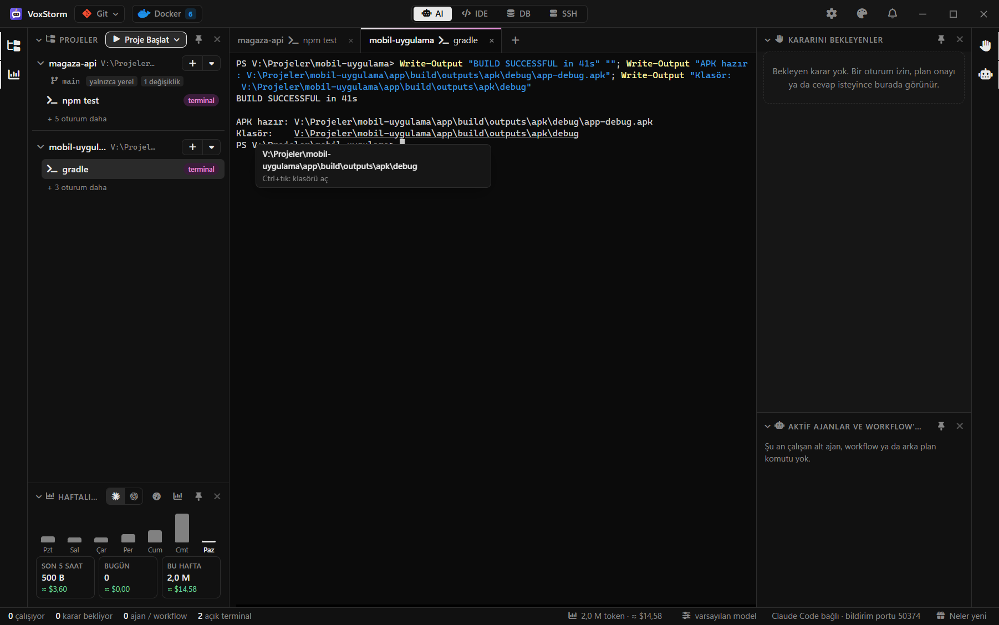
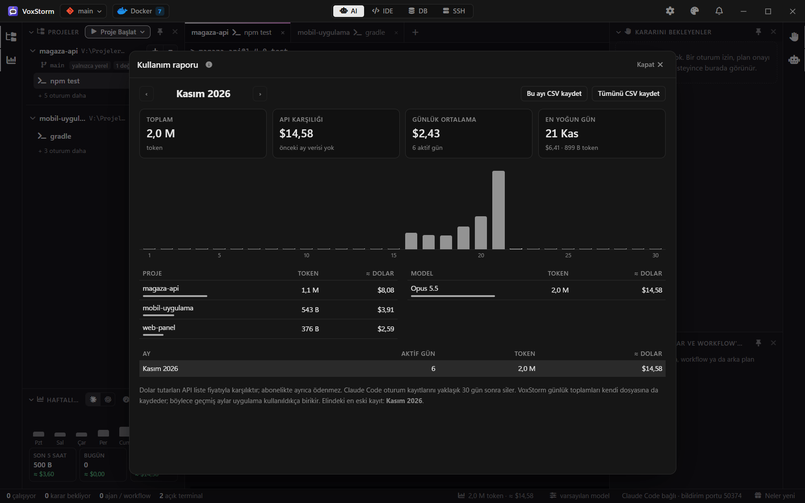
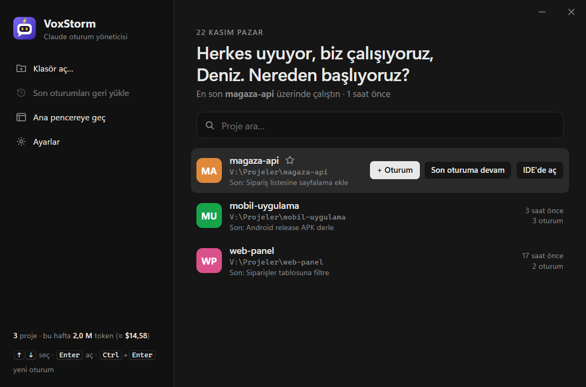
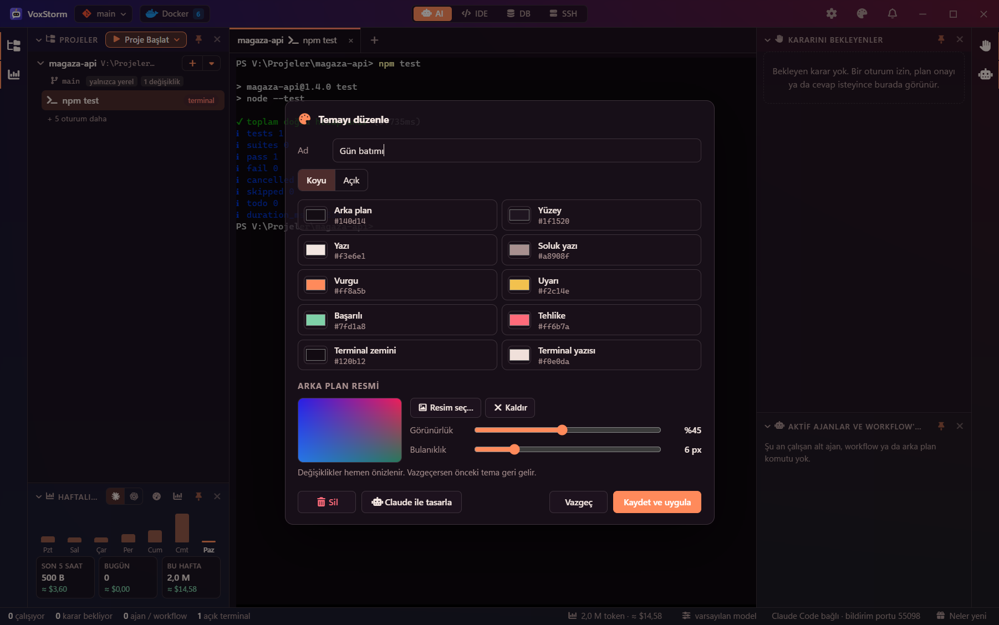
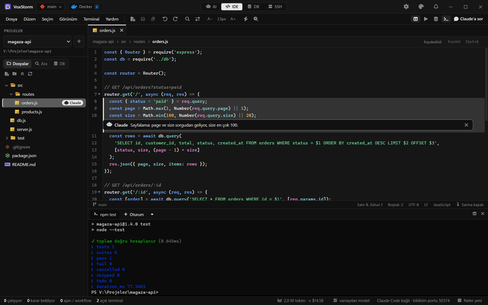
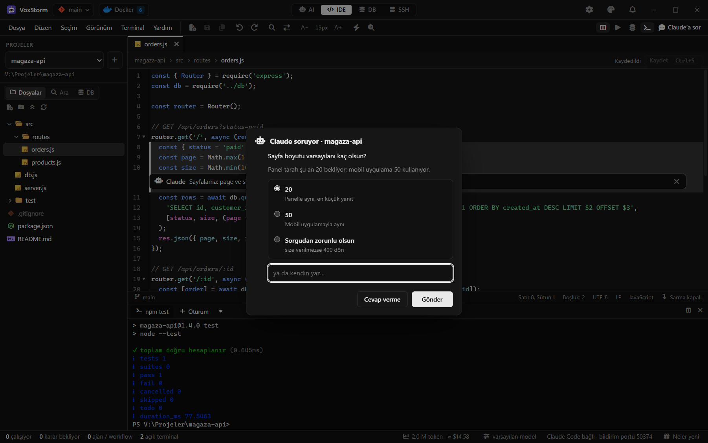
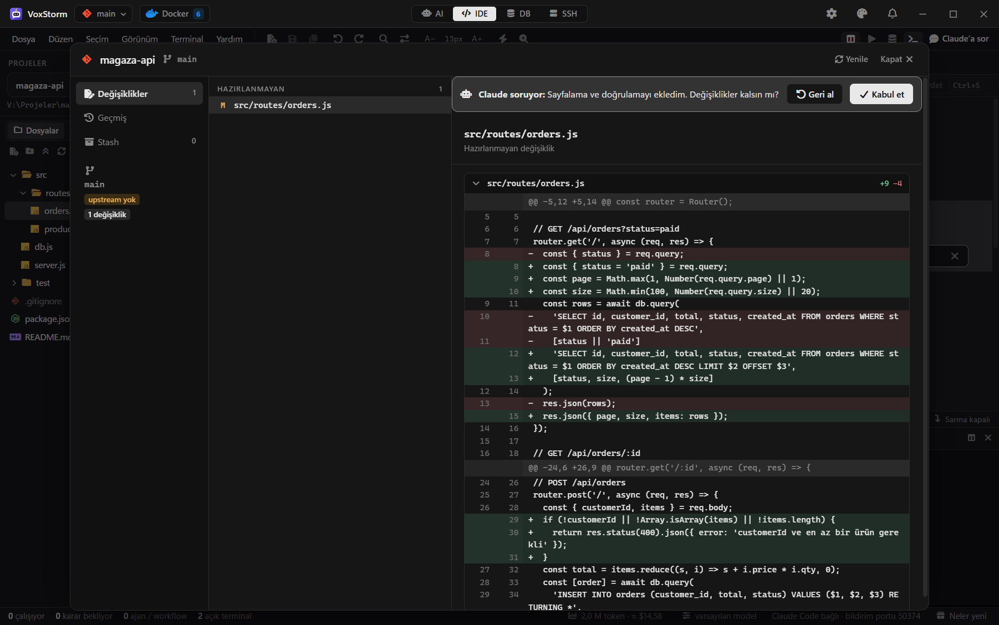

# VoxStorm

Claude Code ve Codex oturumlarını tek pencereden yöneten masaüstü uygulaması. IDE, veritabanı, SSH, Docker ve git aynı yerde; üstelik Claude ve Codex de VoxStorm'u kullanabiliyor: dosyayı senin önünde açar, değişikliği gösterip onay ister, soru sorar, iş bitince haber verir.

Windows, macOS ve Linux'ta çalışır. Arayüz Türkçe, İngilizce, Almanca, İspanyolca ve Fransızca. · *English: [README.en.md](README.en.md)*

> Resmi bir Anthropic ürünü değildir. Bilgisayarında kurulu [Claude Code](https://claude.com/claude-code) (ve/veya OpenAI Codex) ile çalışır.



## İçindekiler

- [Özellikler](#özellikler)
- [Claude ve Codex VoxStorm'u kullanır](#claude-ve-codex-voxstormu-kullanır)
- [Kurulum](#kurulum)
- [Geliştirme](#geliştirme)
- [Nasıl çalışır](#nasıl-çalışır)
- [Proje yapısı](#proje-yapısı)

## Özellikler

### AI modu: oturumlar

- **Sekmeli terminaller:** Claude, Codex, PowerShell, Komut İstemi ve Git Bash yan yana (macOS ve Linux'ta zsh ve bash). Sekme grupları, kapatılanı geri açma, terminale dosya sürükle-bırak.
- **Projeler ve geçmiş:** Eski oturuma tıkla, kaldığın yerden devam et; kapanışta açık olanları geri yükle. Projeye sağ tıkla: IDE'de göster, Gezgin'de aç, geçmişi yenile.
- **Karar paneli:** İzin istekleri, plan onayları ve Claude'un soruları tek yerde.
- **Ajanlar ve workflow'lar:** Alt ajanlar, arka plan komutları ve workflow'lar canlı listede; workflow ayrıntı penceresinde fazlar, ajanlar, token ve süre.
- **VoxStorm dışındaki oturumlar:** Başka bir terminalde açık Claude oturumlarını izle, istersen VoxStorm'a taşı.
- **Bildirimler ve tepsi:** İş bitince, karar beklenince haber verir. Kapatınca tepside çalışmaya devam eder.
- **Tıklanabilir yollar:** Terminalde geçen dosya ve klasör yolları link olur. **Ctrl+tık** ile klasör Gezgin'de, proje dosyası IDE'de (`src/app.js:49` gibi satırıyla) açılır. Boşluklu yollar ve Claude'un alt satıra kırdığı uzun yollar da tanınır; yalnızca diskte gerçekten var olan yollar link olur.

### IDE modu

Dosya ağacı, renkli düzenleyici, Markdown görünümü, bul ve değiştir (regex), çoklu imleç, kod katlama, git renkleri. "Claude'a sor" ile dosyayı ya da seçili satırları açık oturuma gönderirsin. **DB** panelinden SQL'i düzenleyicinin içinde çalıştırırsın.

Dosyalar, Ara, Veritabanı ve Eklentiler AI modundaki gibi **dock paneli**: sağa sola sürükle, alt alta böl, sekmele, raptiyeyle gizle. IDE düzeni AI modundan ayrı saklanır.

### DB, SSH, Docker, git

- **DB modu:** MSSQL, PostgreSQL, MySQL ve MariaDB. Gezgin, sorgu sekmeleri, sonuç tablosu, geçmiş ve kayıtlı sorgular, CSV dışa aktarma.
- **SSH modu:** Kayıtlı sunucular, terminal, iki panelli SFTP dosya yöneticisi, port yönlendirme tünelleri ve Uzak Masaüstü (RDP) kayıtları.
- **Docker:** Konteynerleri başlat / durdur, canlı loglar, konteynerde terminal, compose projeleri, imajlar. Bu bilgisayarda ya da SSH ile bağlandığın sunucuda.
- **Git:** Değişiklikler, geçmiş, stash, fark görünümü, senkronizasyon ve GitHub bilgisi.

### Kullanım

Haftalık ve aylık token, API fiyatıyla dolar karşılığı, proje ve model kırılımı, plan limitleri, CSV dışa aktarma. Claude ve Codex ayrı ayrı.



### Diğerleri

- **Modlar ayrı pencerede:** AI, IDE, DB ya da SSH'yi kendi penceresine al (ör. ikinci monitör).
- **Eklentiler:** Kendi panelini, düğmeni, menü öğeni, komutunu ekle; Claude'a araç sun. Rehber: [`src/plugin-sdk/REHBER.md`](src/plugin-sdk/REHBER.md).
- **Kişiselleştirme:** Hitap ve ton; dock düzeninde sürüklenip bölünebilen yan paneller; kısayollar (F1).
- **Otomatik güncelleme:** Yeni sürüm indirilir, SHA-256 ile doğrulanır, yeniden başlatınca kurulur.



### Temalar

Dört hazır tema (Gece moru, Deniz, Grafit, Kağıt) ve kendi temaların:

- **Tema düzenleyici:** On temel rengi seç (zemin, yüzey, yazı, vurgu, uyarı, terminal…); ara tonları VoxStorm hesaplar, değişiklik anında önizlenir.
- **Arka plan resmi:** Bir resim seç; görünürlüğünü ve bulanıklığını ayarla, paneller resmin üstünde yarı saydam durur.
- **Claude ile tasarla:** "Gün batımı, sıcak turuncu vurgulu koyu tema" de; Claude renkleri seçer, okunur kontrastı gözetir ve temayı kaydedip uygular.



### Dil

Arayüz Türkçe, İngilizce, Almanca, İspanyolca ve Fransızca. İlk açılışta sistem diline göre seçilir; **Ayarlar → Dil**'den değişir. Claude ve Codex'in yanıt dili ayrıca seçilir. Yeni dil eklemek tek bir çeviri dosyası: [`src/i18n/README.md`](src/i18n/README.md).

## Claude ve Codex VoxStorm'u kullanır

VoxStorm'un başlattığı her Claude Code ve Codex oturumu, VoxStorm'un yerel MCP sunucusuna bağlanır. Böylece ajan bir şeyi terminale yazıp bırakmak yerine sana **gösterir** ve **sorar**. Her şey VoxStorm'un kendi arayüzünde olur; sistemin mesaj kutuları kullanılmaz.

Mesela "sipariş uç noktası nerede?" diye sorduğunda VoxStorm öne gelir, IDE'ye geçer, dosya soldaki ağaçta Claude rozetiyle yanıp söner ve editörde açılır; Claude incelemeni istediği satırları notlarıyla işaretleyebilir:



Bir karar gerektiğinde seçenekli soru sorar; cevabın doğrudan oturuma döner:



Yaptığı değişikliği git penceresinde gösterip onay isteyebilir. **Geri al** dersen değişikliği kendisi geri alır:



| Araç | Ne yapar |
|---|---|
| `show_file` | Dosyayı IDE'de açar, ağaçta işaretler; istenirse yalnızca yerini gösterir |
| `highlight_lines` | Satır aralıklarını işaretler, altına not yazar |
| `get_editor_state` | Açık dosya, imleç, seçili metin, kaydedilmemiş dosyalar |
| `show_diff` | Git penceresinde farkı gösterir; istenirse Kabul et / Geri al diye sorar |
| `ask_user` | Seçenekli, çok seçimli ya da yazılı cevaplı soru |
| `notify_user` | Masaüstü bildirimi; tıklayınca oturumun sekmesine gider |
| `run_in_terminal`, `list_terminals`, `read_terminal` | Görünür bir sekmede komut başlatır, terminalleri listeler ve okur |
| `send_to_session` | Başka bir Claude / Codex oturumuna mesaj gönderir (ilk seferde onay sorulur) |
| `docker_list`, `docker_logs`, `docker_action` | Bu bilgisayardaki konteynerler; başlat / durdur / yeniden başlat onayla |
| `list_connections`, `ssh_exec`, `ssh_upload`, `ssh_download` | Kayıtlı SSH sunucularında komut ve SFTP; `sudo` gerekirse parola VoxStorm'da sorulur |
| `db_query`, `show_query` | Kayıtlı veritabanlarında sorgu; sonucu DB modunda tablo olarak gösterme |
| `list_plugin_tools`, `call_plugin_tool` | Eklentilerin sunduğu araçlar |
| `get_theme`, `save_theme` | Arayüz temasını okur; yeni tema tasarlayıp kaydeder ve uygular |

**Güvenlik:** SSH ve veritabanı bağlantılarının adresi, kullanıcı adı ve parolası ajana hiç verilmez; bağlantıyı VoxStorm kurar, ajan yalnızca çıktıyı görür. Bir bağlantı ilk kullanılırken sorulur (istersen "her zaman hatırla"). **sudo** gereken komutlarda VoxStorm önce parolasız sudo dener; gerekirse parolayı kendi penceresinde, çalışacak komutla birlikte sorar ve `sudo -S` ile komuta iletir; parola ajana verilmez. Salt okunur bağlantılarda yazma engellenir; DROP, TRUNCATE ve WHERE'siz UPDATE/DELETE her seferinde ayrıca sorulur. SSH ve DB araçlarını Ayarlar'dan kapatabilirsin; diğer araçlar açık kalır.

## Kurulum

[Releases](../../releases) sayfasından indir.

### Windows

- `VoxStorm-Setup-x.y.z.exe`: normal kurulum
- `VoxStorm-Portable-x.y.z.exe`: kurulumsuz, tek dosya

Gerekenler: Windows 10/11 ve PATH'te `claude` (Claude Code) ve/veya `codex` komutu. Git Bash isteğe bağlı.

Dosyalar imzasız olduğu için Windows ilk açılışta uyarı verebilir: **Ek bilgi → Yine de çalıştır**.

### macOS

- `VoxStorm-x.y.z-mac-arm64.dmg`: Apple Silicon (M1 ve sonrası)
- `VoxStorm-x.y.z-mac-x64.dmg`: Intel Mac

Gerekenler: macOS 12+ ve `claude` komutu (Claude Code). VoxStorm, Finder'dan açılsa da giriş kabuğunun PATH'ini okur; Homebrew veya `~/.local/bin` altındaki `claude`, `git`, `gh` bulunur.

Uygulama Apple tarafından onaylanmadığı (notarize edilmediği) için ilk açılışta uyarı çıkar: Uygulamalar klasöründe VoxStorm'a **sağ tık → Aç → Aç**. Uyarı yine de açtırmazsa: `xattr -dr com.apple.quarantine /Applications/VoxStorm.app`

macOS'taki farklar:

- Uygulama kısayolları **⌘** ile çalışır (⌘1, ⌘⇧P, ⌘P…); **⌃ Control** terminalde kalır (⌃C durdurur, ⌃R arar). Sekmeler arasında ⌃Tab. Terminal yollarını **⌘+tık** açar.
- Sistem tepsisi yerine menü çubuğu simgesi; Dock simgesine tıklayınca pencere geri gelir.
- Plan limitleri, Claude Code'un Anahtar Zinciri'ndeki girişiyle okunur; ilk seferde macOS izin sorabilir.
- VoxStorm dışında açık oturumların terminaline bağlanma (ayna) yalnızca Windows'ta var; macOS'ta konuşma izlenir, **VoxStorm'a taşı** ile devam edilir.
- Otomatik güncelleme için VoxStorm Uygulamalar klasöründe olmalı; .dmg içinden ya da İndirilenler'den doğrudan açılan kopya kendini güncelleyemez.

### Linux

- `VoxStorm-x.y.z-linux-x86_64.AppImage`: her dağıtımda çalışır, kendini günceller. `chmod +x` ile çalıştırılabilir yap. Ubuntu 22.04 ve sonrasında AppImage için `libfuse2` (24.04'te `libfuse2t64`) gerekir.
- `VoxStorm-x.y.z-linux-amd64.deb`: Debian / Ubuntu: `sudo apt install ./VoxStorm-x.y.z-linux-amd64.deb`. Güncellemeler bildirilir, yeni .deb'i aynı şekilde kurarsın.

Gerekenler: x64 Linux, `claude` (ve/veya `codex`) komutu, `curl` (hook'lar için). VoxStorm giriş kabuğunun PATH'ini okur; `~/.local/bin`, `~/.npm-global/bin` ve `/snap/bin` de aranır.

Linux'taki farklar:

- Kısayollar Windows'taki gibi **Ctrl** ile; terminaller bash ve zsh.
- Kaydedilen parolalar sistemin anahtarlığında (GNOME Keyring / KWallet) şifrelenir; anahtarlık yoksa parola kaydedilmez, her bağlantıda sorulur.
- Uzak Masaüstü FreeRDP (`xfreerdp3` / `xfreerdp`) ya da Remmina ile açılır. Eklenti paketleri için `zip` / `unzip` gerekir.
- Docker yerelde Docker Engine ya da Docker Desktop ile çalışır; kullanıcının `docker` grubunda olması gerekir.
- Dışarıda açık oturumların terminaline bağlanma (ayna) yok; macOS'taki gibi konuşma izlenir.

## Geliştirme

```
npm install
npm start          # uygulamayı çalıştır
npm run pack       # yalnızca dist/win-unpacked (hızlı deneme derlemesi)
npm run dist       # Windows: Setup ve Portable dosyalarını dist/ klasörüne derle
npm run dist:mac   # macOS: .dmg ve .zip (arm64 + x64)
npm run dist:linux # Linux: .AppImage ve .deb (x64); Linux'ta çalıştır
```

## Nasıl çalışır

- **Hook'lar:** Claude oturumları VoxStorm'un kendi hook ayarlarıyla (`--settings`) başlatılır. Hook'lar olayları uygulamanın yerel portuna gönderir; durumlar, bildirimler ve karar paneli buradan beslenir. `~/.claude/settings.json` ve `CLAUDE.md` dosyalarına dokunulmaz.
- **MCP sunucusu:** Her oturuma, yalnızca `127.0.0.1`'de dinleyen ve oturuma özel bir adres verilir (Claude: `--mcp-config`, Codex: `-c mcp_servers…`). Ajanın araç çağrıları buradan VoxStorm'a gelir; pencereye düşen işler (dosya açma, soru, fark) arayüzde yapılır.
- **Geçmiş ve kullanım:** `~/.claude/projects` altındaki oturum kayıtlarından (Codex için `~/.codex/sessions`) okunur.
- **Ayarlar:** Proje listesi ve günlük kullanım geçmişi `%APPDATA%\VoxStorm` (macOS'ta `~/Library/Application Support/VoxStorm`, Linux'ta `~/.config/VoxStorm`) klasöründe tutulur.

## Proje yapısı

| Dosya | Görevi |
|---|---|
| `src/main/main.js` | Pencereler, tepsi, terminal süreçleri, hook dinleyicisi, geçmiş ve kullanım |
| `src/main/agentlink.js` | Oturumlara verilen MCP sunucusu; SSH / DB araçları ve izin soruları |
| `src/main/agenttools.js` | Çalışma alanı araçları: IDE, git, soru, bildirim, terminaller, Docker, eklentiler |
| `src/main/ssh.js`, `db.js`, `docker.js`, `git.js`, `ide.js` | SSH / SFTP, veritabanları, Docker, git ve dosya işlemleri |
| `src/main/codex.js` | Codex oturumları, geçmişi ve kullanımı |
| `src/main/plugins.js` | Eklentilerin yüklenmesi ve izinleri |
| `src/main/preload.js` | Arayüze açılan sınırlı API |
| `src/main/platform.js` | Windows / macOS / Linux farkları: PATH, kabuklar, komut bulma |
| `src/renderer/` | Ana pencere (`index.html`, `app.js`, `styles.css`), modlar (`db.js`, `ssh.js`, `docker.js`), karşılama ekranı (`welcome.*`) |
| `src/renderer/agentapi.js` | Ajan araçlarının pencere tarafı |
| `src/renderer/termpaths.js` | Terminaldeki yolları tıklanabilir yapar |
| `src/renderer/ui.js` | Temalı diyaloglar ve ipuçları |
| `src/renderer/themes.js`, `src/main/themes.js` | Özel temalar, tema düzenleyici, arka plan resimleri |
| `src/i18n/` | Arayüz dilleri: çekirdek ve çeviri dosyaları; denetim: `node scripts/i18n-check.js` |
| `src/plugin-sdk/` | Eklenti SDK'sı, örnek eklenti ve rehber |
| `scripts/make-icon.js` | Uygulama simgesini üretir |
